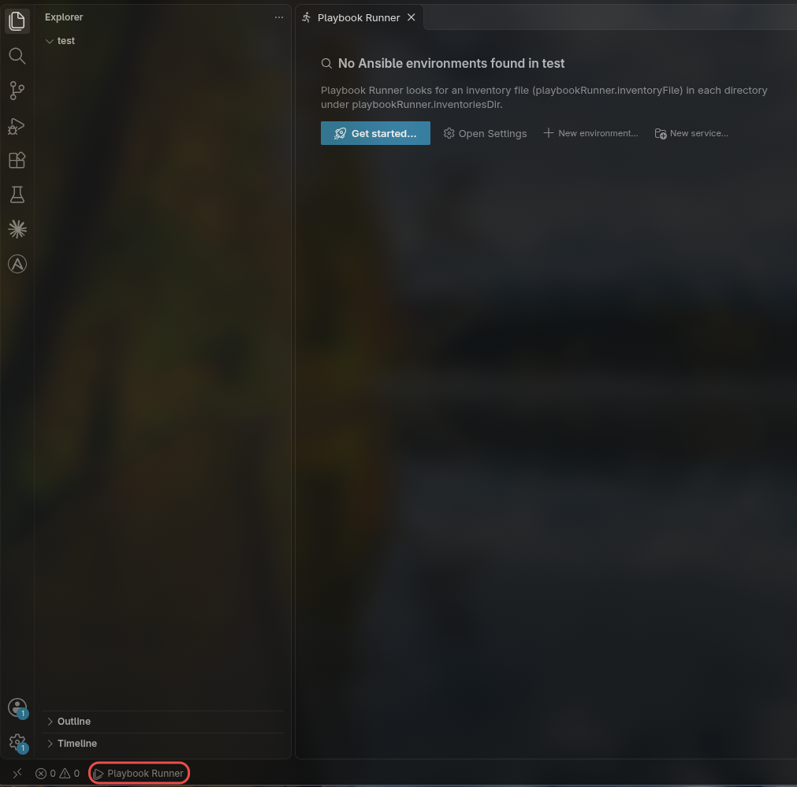
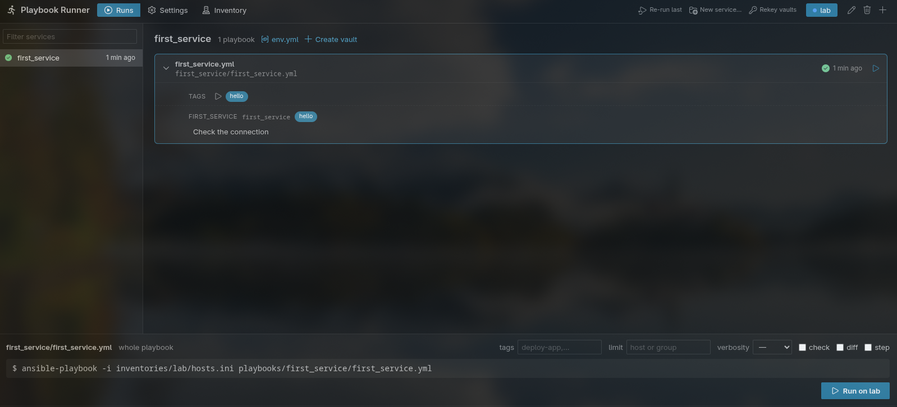
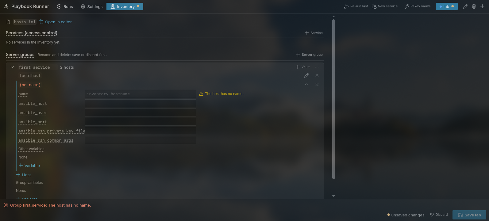

# Playbook Runner

A VS Code dashboard for the Ansible repository in your workspace: run
playbooks — whole, by tag, or a range of their tasks — edit vaults, and edit
each environment's inventory. Environments, playbooks and vaults are
**discovered from the filesystem**: adding `inventories/lab/hosts.ini` or a
folder under `playbooks/` shows up without any configuration.

## Requirements

* `ansible-playbook` and `ansible-vault` (ansible-core 2.x; task ranges are
  tested with 2.21 and 2.22).
* A Linux shell with GNU coreutils (runs start with `env -C <folder> …`). On
  another OS, use Remote — SSH, WSL or Dev Containers.
* Shell integration in that shell, so the run history can tell a passed run
  from a failed one (without it, runs show as *unknown*).

## Install

Search for *Playbook Runner* in the Extensions view (Visual Studio Marketplace
and Open VSX), or:

```bash
code --install-extension sebgad.playbook-runner
```

Open a workspace laid out as below and click **Playbook Runner** in the status
bar. To run it from source, see [CONTRIBUTING.md](CONTRIBUTING.md).

## Repository layout

Every name here is a setting (see [Configuration](#configuration)):

```
ansible.cfg
playbooks/
  <service>/            ← one folder per service, holding its *.yml playbooks
inventories/
  <environment>/        ← any directory with a hosts.ini is an environment
    hosts.ini
    group_vars/
      <service>/
        env.yml         ← plain variables
        vault.yml       ← ansible-vault encrypted variables
roles/
```

A *service* is `playbooks/<name>/` and `group_vars/<name>/` shown as one
thing; either half may be missing. Loose playbooks under `playbooks/` are
listed as `(root)`.

**Starting from an empty folder:** the dashboard offers **Get started…**. It
asks for an environment and a service name and creates the tree above, with a
starter playbook (one `ansible.builtin.ping` task tagged `hello`) and
`localhost` in the inventory, so ▶ works right away. Replace `localhost` with
your hosts afterwards.



## Dashboard

The **`$(run-all) Playbook Runner`** status bar item (or *Playbook Runner:
Open Dashboard*) opens the dashboard as an editor tab. The item next to it
shows the newest run and runs it again on click.



```
┌ Playbook Runner  Runs|Settings|Inventory  ↻ Re-run last  ⊕ New service…  ⚿ Rekey vaults  [● production] [● staging] ┐
│ ⚠ production — runs here ask for confirmation before they start.                                │
├──────────────────┬───────────────────────────────────────────────────────────────────────────────┤
│ Filter services  │ authentik   1 playbook   env.yml   🔒 Edit vault                              │
│ ≡ all            │ ▾ authentik.yml                                    ✓ 3 min ago   ▶            │
│ ✓ authentik   3m │   TAGS ▷ podman-user-setup  ▷ deploy-app  ▷ nginx-reverse-proxy …               │
│ ✗ dns_servers 1d │   CREATE USER …  podman_servers  [podman-user-setup] …                        │
│ ○ immich         │   SETUP  podman/user : Ensure podman_user is defined                          │
│ …                │   FROM   podman/deploy-app : Get podman user UID                              │
│                  │   UNTIL  podman/deploy-app : Set podman user UID fact                         │
├──────────────────┴───────────────────────────────────────────────────────────────────────────────┤
│ authentik/authentik.yml  from … until … ✕       tags [   ] limit [   ] verbosity [—] ☑ check      │
│ $ env -C … ANSIBLE_STRATEGY=playbook_runner_range … ansible-playbook -i … --check               │
│                                                                           [ ▶ Run on staging ]  │
└──────────────────────────────────────────────────────────────────────────────────────────────────┘
```

* **Environments** are the tabs at the top. One matching
  `playbookRunner.productionPattern` is red, and every write or run there asks
  for confirmation first. ✎, 🗑 and ＋ next to them rename, delete and add an
  environment.
* **Services** are the list on the left, each with its newest run; one with
  only variables (such as `all`) has a variables icon. Variables are per
  environment and playbooks are not, so a service can differ between
  environments.
* **A service** shows its playbooks, a link to its `env.yml`, and **Edit
  vault** (or **Create vault** while it has none). Vaults open in a terminal of
  their own.
* **A playbook card**: ▶ runs it. Expanded, it lists its **tags** in run order
  (▷ runs one tag, a click adds it to `--tags`) and its tasks. Click a task to
  start a range there and another to end it; hover a row for *only*, *from*,
  *until* and *open in the editor*.
* **The run bar** holds tags, `--limit`, verbosity, `--check`, `--diff`,
  `--step`, and the **exact command line** the run will get.
* **The top bar**: *Re-run last*, *New service…* and *Rekey vaults*.
* **The Settings tab** edits every setting below, shows where its value comes
  from, and checks a value before saving it. Changes go to the workspace's
  `.vscode/settings.json`, except the ⁽ᵐ⁾ settings, which always go to User
  settings.
* **The Inventory tab** edits the inventory — see below.

Every run goes the same way, whichever button started it: task-range check,
production confirmation, last-run record, history. The palette commands (*Run
Playbook*, *Edit Vault*, …) work without the dashboard, through QuickPicks.

## Editing the inventory

The **Inventory** tab edits the INI inventory of the environment shown:

* **Services (access control)** — groups with a `[service:children]` section.
  Tick which server groups belong to each service.
* **Server groups** — their hosts, each with its SSH login (`ansible_host`,
  `ansible_user`, `ansible_port`, `ansible_ssh_private_key_file`,
  `ansible_ssh_common_args`) and other variables, plus group variables and the
  group's vault.
* **Manual sections** — hand-written parts, shown read-only.

Hover a field, a section heading or a known `ansible_*` variable for what it
means.



```
┌ Inventory · hosts.ini                                                  Open in editor ┐
│ SERVICES (access control)                                                             │
│   immich     ☑ podman_servers  ☐ dns_servers                         Vault  …         │
│ SERVER GROUPS                                                                         │
│ ▾ podman_servers                                                     Vault  …         │
│     web1   10.0.0.5  user admin  key ~/.ssh/id_ed25519                                │
│     GROUP VARIABLES  Variable [   ] = [   ]                                           │
│ MANUAL SECTIONS   [legacy] …                                         Open in editor   │
├───────────────────────────────────────────────────────────────────────────────────────┤
│ ⚠ warnings the save will cause           ● unsaved changes   Discard   Save staging   │
└───────────────────────────────────────────────────────────────────────────────────────┘
```

Edits stay a draft (`●`) until *Save*. Save lists every change and offers
*Show diff* before anything is written.

**The file is rewritten in a standard layout.** Comments outside manual blocks
are dropped and duplicate sections merged; the confirmation warns about both.
Values in `[group:vars]` are kept exactly as written. To keep a part as it is,
wrap it in marker lines:

```
# playbook-runner: manual begin
[legacy]
old-box ansible_host=10.0.0.9
# playbook-runner: manual end
```

* **No passwords** in the inventory: `ansible_password`, `ansible_ssh_pass`,
  `ansible_become_pass` and `ansible_become_password` are refused. Use the
  group's vault.
* **A save is refused** while the file has unsaved edits in an editor, while a
  playbook runs against the environment, or when the file changed on disk
  since the page loaded. *Discard* then reloads it.
* **Rename and delete** (a group's `…` menu) work for server groups and
  services. A rename also renames the group's `group_vars/<name>/` and its
  entries in other services. A delete removes it from every service and offers
  to move its `group_vars/<name>/` to the trash. Anything else that still names
  the group (playbooks, manual blocks, `<name>.yml` variable files) is listed,
  not changed.
* **Only INI inventories** can be edited. A folder under `inventories/`
  without an inventory file offers *Create inventory*.

## Running part of a playbook

`--start-at-task` skips every earlier task, including the ones that set facts
later tasks need, and there is no way to stop at a task. So a range run
switches on a strategy plugin shipped with the extension
(`ansible/strategy/playbook_runner_range.py`) for that one run:

* before the start: fact gathering, `include_*` tasks, and tasks tagged with a
  `playbookRunner.setupTags` tag (none by default — list the tags of tasks
  that set facts, e.g. `["user-setup"]`);
* from the start to the end: everything;
* after the end: only handlers already notified. Later plays are skipped.

Task names match exactly as written, roles included
(`podman/deploy-app : Render manifest`). A range that cannot work is refused
before anything runs: an unknown task, an end before the start, or a playbook
that sets `strategy:` or `serial:`. A range run started outside Playbook Runner
is refused; use *Re-run Last* instead.

## Where the tag list comes from

Tags are read from the YAML: the playbook, the playbooks it imports, and the
task files of the roles it uses (`playbookRunner.rolesDir`). This is faster
than `ansible-playbook --list-tags` and needs no inventory or vault
passphrase, but it is a line scanner: a tag built from a variable is missed.
*Other…* at the end of the list lets you type tags yourself. A tag ticked
last time that has since disappeared stays in the list, marked.

## Vaults

**Passwords**, per environment, in this order:

1. `playbookRunner.vaultPasswordFiles["<env>"]`, if set;
2. `playbookRunner.vaultPasswordFilePattern`, by default
   `${userHome}/.ansible-vault/${env}.pass`;
3. if that file does not exist, `--ask-vault-password` — but only when the
   environment has something encrypted (a vault file or an inline `!vault`
   value). Without one, a run asks for nothing.

```jsonc
"playbookRunner.vaultPasswordFiles": {
  "production": "${userHome}/.ansible-vault/prod.pass"
}
```

**Rekey vaults** passes every `vault.yml` of the environment to one
`ansible-vault rekey`. The new passphrase is always typed at the prompt, never
passed as an argument. Commit first: a failure part-way leaves some vaults on
the new passphrase. Afterwards, update the password file yourself.

## Adding a service

*New service…* (or *Create Service Skeleton…*) asks for a name and creates
`playbooks/<name>/` and an empty `group_vars/<name>/env.yml` in every
environment — or only those in `playbookRunner.serviceEnvironments`. Run on an
existing name, it fills in only what is missing. *With a starter playbook*
also writes `playbooks/<name>/<name>.yml`. No file is ever overwritten, no
vault is created (use **Create vault**), and no hosts are added (use the
Inventory tab).

## Adding, renaming and deleting an environment

* **＋ New environment** creates `inventories/<name>/` with an inventory file.
  Modelled on another environment, it copies that environment's group names
  and empty env files — never its hosts or vaults.
* **✎ Rename** moves the directory, along with the settings, run history and
  *Re-run last* that name it.
* **🗑 Delete** moves the directory to the trash, vaults included, after you
  type its name.

Rename and delete are refused while a playbook runs against the environment.

## How things are run

* **Playbooks** run in a reused `Playbook Runner` terminal, so prompts
  (`--ask-vault-password`, `become`, SSH passphrases) and Ctrl+C work. The
  line is ` env -C <workspace folder> ansible-playbook <args>`, with every
  argument quoted. The leading space keeps it out of shell history.
* **Vaults** open in a terminal of their own, because `ansible-vault edit`
  starts `$EDITOR`.
* Both run in the workspace folder, because `ansible.cfg` is only read from
  there.

The extension does not run in untrusted or virtual workspaces. The ⁽ᵐ⁾
settings name something that gets executed (Ansible runs an executable vault
password file), so a repository's `.vscode/settings.json` cannot set them.

## Configuration

| Setting | Default | Meaning |
| --- | --- | --- |
| `playbookRunner.playbooksDir` | `playbooks` | Where the playbook folders live. |
| `playbookRunner.rolesDir` | `roles` | `ansible.cfg`'s `roles_path`; read when collecting a playbook's tags. |
| `playbookRunner.inventoriesDir` | `inventories` | One subdirectory per environment. |
| `playbookRunner.inventoryFile` | `hosts.ini` | A directory counts as an environment when it contains this. |
| `playbookRunner.groupVarsDir` | `group_vars` | Group variables directory inside an environment. |
| `playbookRunner.envFileName` | `env.yml` | Unencrypted variables file inside a group. |
| `playbookRunner.vaultFileName` | `vault.yml` | Vault file inside a group. |
| `playbookRunner.vaultPasswordFilePattern` ⁽ᵐ⁾ | `${userHome}/.ansible-vault/${env}.pass` | Supports `${userHome}`, `${workspaceFolder}`, `${env}`. Empty always prompts. |
| `playbookRunner.vaultPasswordFiles` ⁽ᵐ⁾ | `{}` | Per-environment override of the pattern. |
| `playbookRunner.productionPattern` | `production` | Case-insensitive regex; matching environments are red and confirmed. Empty disables. |
| `playbookRunner.confirmProduction` | `true` | Ask before running against or writing to a production environment. |
| `playbookRunner.ansiblePlaybookCommand` ⁽ᵐ⁾ | `ansible-playbook` | E.g. a virtualenv path or `uv run ansible-playbook`. |
| `playbookRunner.ansibleVaultCommand` ⁽ᵐ⁾ | `ansible-vault` | |
| `playbookRunner.setupTags` | `[]` | Tags whose tasks still run before a task range starts. Empty makes *From task* behave like `--start-at-task`. |
| `playbookRunner.serviceEnvironments` | `[]` | Environments *New service…* creates a service in. Empty means all. |

⁽ᵐ⁾ `machine` scope: User settings only, never set by a workspace.

## License

[MIT](LICENSE)
